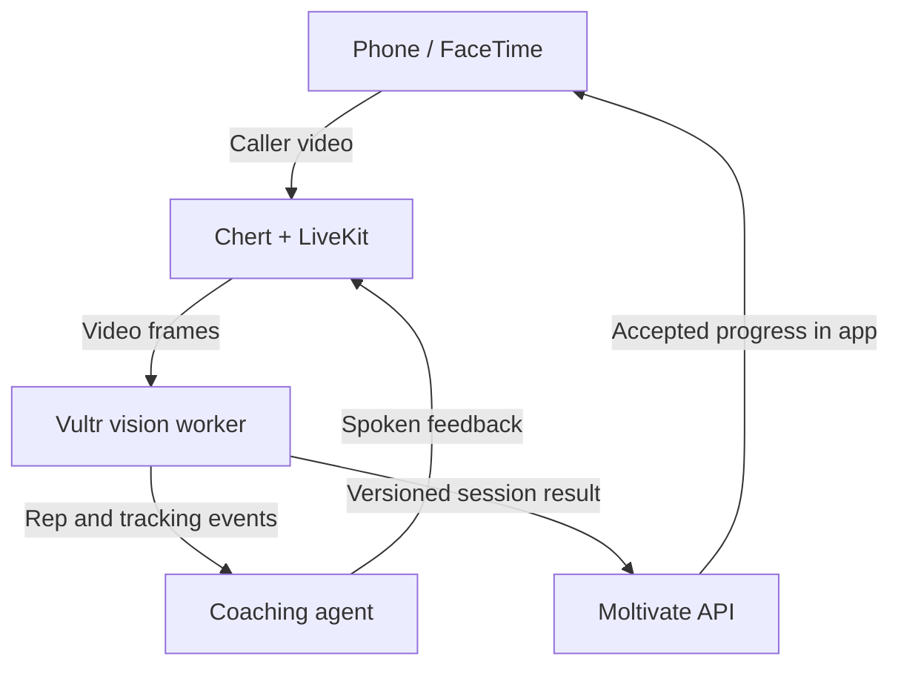

# Moltivate — AI Workout Coach & Pose Verification

**Status:** Proposed implementation brief; capabilities and workout rules still need to be tested.  
**Prepared:** November 14, 2026  
**Updated:** November 14, 2026 — dedicated Vultr worker and video-processing flows.  
**Goal:** Help people complete their workouts with a live skeleton overlay, rep counting, and useful coaching, while giving Moltivate a foundation for challenge verification.

## The idea

You prop your phone up, step into the frame, and start your set. Moltivate places dots on your joints and connects them into a moving stick figure. It tracks your movement, counts completed reps, and gives feedback when it can confidently identify an issue.

Chert could bring the conversational side to life: an AI coach you can talk to through FaceTime or message through iMessage. The experience should feel like someone helping you show up and finish your set.

The technology is **human pose estimation**, also called **skeletal tracking**. Gesture recognition can be built on top of the tracked movement.

## What each component does

| Component | Proposed responsibility |
| --- | --- |
| Phone camera and app UI | Guide camera placement, show the skeleton, display rep progress and tracking status. |
| Main API | Manage users, challenges, authorized workout sessions, and accepted results. |
| Dedicated Vultr vision VM | Decode video, run pose inference and exercise rules, and return session results without using the main API's CPU or memory. |
| MediaPipe Pose Landmarker | Estimate body landmarks from camera frames inside the vision worker. |
| Exercise evaluator | Calculate joint angles and track movement phases using tested, exercise-specific rules. |
| Coaching agent | Turn structured exercise events into short, relevant spoken or written feedback. |
| Chert | Connect the agent to supported iMessage or FaceTime experiences. |
| Backend verifier | Evaluate challenge evidence on the worker; return an authenticated, versioned result for the API to validate and record once. |
| Solana integration | Settle a challenge only after the backend authorizes its result. Keep the prototype on simulated balances or test funds. |

**Verified capability:** MediaPipe provides 33 estimated body landmarks, including image and 3D world coordinates, with visibility/presence information. These are inputs to our evaluator; they do not include a ready-made verdict that a workout was performed correctly. [1]

**Chert dependency:** Chert documents a FaceTime bridge to a LiveKit room we control. Caller-camera capture and outgoing agent video are separate capabilities. We must confirm caller-camera access on our assigned line and test the integration before promising a FaceTime workout coach. [2][3]

## Dedicated Vultr processing

For this coaching extension, use a **separate Vultr VM for the vision worker**. The website/mobile app renders the experience, and the core API handles small requests and result records. Heavy video decoding and pose analysis run on the worker.

This remains server-side compute. The benefit is isolating the workload and scaling it independently. Separate containers on one VM still share that VM's CPU and memory; they do not provide the same resource separation. This proposed split extends the repository's initial single-VM deployment plan for the AI-coach feature. It does not mean a VM has already been provisioned.

Keep video processing out of API request handlers. Send media directly to the approved streaming or private-storage destination, and pass only session identifiers, job references, and compact results through the core API.

### Live coaching flow

The conditional FaceTime route would look like this:

1. The API authorizes a workout session and binds it to the participant and challenge.
2. With caller capture enabled, the worker subscribes to the relevant LiveKit video track and processes timestamped frames.
3. The worker returns pose data for an in-app overlay and compact exercise events for the coaching agent. Overlay data must match a sufficiently recent preview frame; clear stale overlays rather than drawing them over unrelated movement.
4. The coach explains those events through Chert. The API records a final result only after its verification checks pass.

Use a small, bounded frame buffer. If processing falls behind, discard stale frames for live feedback rather than accumulating delayed advice. Record tracking gaps and reset incomplete reps when necessary. If the evidence becomes too sparse, return a retry state instead of guessing completion.

Chert documents connecting caller frames to our own vision pipeline. Caller capture must be enabled, and the track can contain FaceTime controls, names, or self-preview rather than a clean camera feed. Test framing, changing images, camera mute, and track replacement before relying on this input. [5]

The in-app camera route can use an authenticated media stream to the worker independently of FaceTime. That transport still needs to be implemented and tested. Chert is optional for video ingestion in this route and remains useful for coaching or session summaries.

### Recorded verification flow

1. The API creates an authorized session and a short-lived upload URL.
2. The app uploads its clip directly to private object storage.
3. After upload validation, the API enqueues a verification job. A Postgres-backed job table is sufficient for the first version.
4. The Vultr worker claims the job, reads the clip, evaluates it, and submits the result through an authenticated internal interface.
5. The API records the result once and makes it available to the app and leaderboard.

Use bounded retries and job leases so an interrupted worker can recover. Duplicate job delivery must not credit a workout twice. Recorded verification can process asynchronously; it does not need to share the live-feedback latency target.

### Capacity, failures, and cost

Start by benchmarking one squat session on a CPU VM. Vultr offers CPU and GPU instance options, but we have not measured which size is appropriate for this workload. [6]

Measure:

- Sustained processing frame rate and camera-to-feedback delay.
- CPU, memory, and network usage per active session.
- Recorded-clip processing time and queue wait time.
- Error rates and performance with a small increase in concurrent sessions.
- Total usage across compute, media transport, storage, and the coaching model.

Choose an initial session limit from those measurements. Reject or defer new sessions clearly when capacity is full. Put live sessions and recorded jobs under separate capacity limits so background processing cannot make live coaching unusable; split them across workers if benchmarking shows contention.

A worker outage should leave normal app pages and account requests available while verification shows a pending or retry state. Do not convert processing failures into failed workouts. Keep the existing challenge deadlines and refund rules intact.

The worker should have scoped access to its media and result interface. Settlement signing keys belong in the settlement service, not the video-processing VM.

## Recommended first version

Build **one-person bodyweight squat tracking** with a documented camera position and full-body framing.

The MVP should include:

- Camera permission and a clear framing guide.
- A live skeleton overlay.
- Rep counting based on a complete movement sequence.
- A visible “tracking,” “reposition camera,” or “set complete” state.
- One useful cue at a time.
- A session summary with completed reps and any tracking gaps.
- A sample challenge result, clearly identified as a prototype.

Defer other exercises, crowded scenes, detailed hand gestures, and automatic real-money settlement until the first movement is tested.

## How a squat session works

1. **Frame and calibrate.** Confirm the required landmarks are visible and stable. Guide the person into the supported camera position and establish their starting pose.
2. **Track movement.** Follow the relevant hip, knee, ankle, and shoulder landmarks over time.
3. **Calculate useful measurements.** For example, the hip–knee–ankle angle describes knee flexion. Smooth noisy measurements without hiding sustained tracking failures.
4. **Follow the rep phases.** Track ready → lowering → bottom → rising → completed. Count once after a complete accepted sequence.
5. **Give feedback.** Publish a specific event when a tested rule is met or tracking needs correction.
6. **Finish the set.** Show accepted reps, tracking interruptions, and a clear next action.

For three landmarks A, B, and C, the angle at B can be calculated from the vectors A−B and C−B using their dot product. Guard against zero-length vectors and numerical rounding errors.

Use separate entry and exit thresholds, minimum phase durations, and a cooldown to prevent jitter from counting extra reps. Reset or suspend a rep after a substantial tracking gap.

**Do not choose one universal angle and call it “proper form.”** Rules need to account for the exercise, camera position, body proportions, and intended movement range. Validate them with qualified coaching input and representative recordings before using them to judge participants.

## Coaching behavior

The exercise evaluator should produce structured events such as:

- `tracking_lost`
- `camera_reposition_needed`
- `rep_completed`
- `movement_criterion_not_met`
- `set_completed`

The agent can translate these into natural feedback:

> “Move back a little—I can’t see your feet.”

> “That’s five completed reps. Five to go.”

> “Tracking dropped for that rep. Let’s reset.”

Keep feedback brief and rate-limited. The coach should explain the evaluator’s findings without inventing measurements or claiming a rep was accepted when the evaluator did not accept it.

A raised-hand gesture could later start a set. Require a deliberate hold and debounce it so normal exercise movement does not accidentally trigger controls.

## Chert integration plan

**Start with the in-app camera flow.** Render the camera preview and skeleton in Moltivate, with the dedicated Vultr worker doing the heavy pose analysis. Return timestamped landmarks and feedback to the app. A separate Chert integration could send reminders and session summaries through iMessage.

**Then test FaceTime coaching.** On a caller-video-enabled Chert line, connect the LiveKit video track to the Vultr worker and return spoken feedback through the agent. Confirm usable caller frames, latency, camera-mute handling, and session cleanup with an actual call before treating this path as supported.

Do not assume a custom skeleton overlay can be drawn inside the caller’s native FaceTime UI. That display behavior needs its own integration check; the in-app overlay remains the simplest first implementation.

Questions to confirm with Chert:

- Does our assigned line support incoming caller-camera capture?
- Can our LiveKit agent subscribe to usable video frames and timestamps?
- What frame rate, resolution, and latency can we expect in practice?
- How should we feed structured workout events into the agent?
- What concurrency, usage, and session-duration limits apply?

## Verification and money

Keep coaching separate from challenge authorization.

Client-side rep counts provide immediate feedback, but users can modify client output. For a wager-backed challenge, the backend must independently evaluate trustworthy session evidence before approving a result. An uploaded landmark summary alone is not sufficient proof.

Bind evidence to the authenticated participant, challenge, and session. Track evaluator versions, timestamps, and duplicate submissions. Pose estimation alone does not establish identity or prevent replayed videos; those require separate checks.

When confidence is low, return **“unable to verify—retry”**. Do not silently count the rep or automatically penalize the participant.

If independent verification and anti-replay checks are unfinished, keep the demonstration on simulated balances or test funds.

## Accuracy and privacy boundaries

A single camera estimates depth. Occlusion, poor lighting, framing, and orientation can degrade tracking. The model’s own documentation describes these limitations. We can assess selected movement criteria; we cannot guarantee complete or safe technique from a skeleton overlay. [4]

Request camera access only when needed. Keep lightweight preview and overlay rendering in the app, and explain that video is transmitted to the worker for cloud analysis. Optional local pose inference could later improve feedback latency, but client output remains untrusted for rewards. Define retention for any stored verification clips and avoid keeping raw video by default. Keep provider credentials on the server.

## Suggested build order

1. **Vision/UI:** Camera preview, framing guide, and timestamped landmark overlay.
2. **Vultr worker:** Containerize the pose pipeline, run it separately from the API, and benchmark one CPU session.
3. **Exercise logic:** Squat phase tracking, rep counting, confidence handling, and tracking-gap recovery.
4. **Recorded verification:** Private direct uploads, queued jobs, bounded retries, and independently evaluated sample results.
5. **Validation:** Test full and partial reps, pauses, occlusion, different bodies, clothing, lighting, camera positions, and worker failures.
6. **Live coaching:** Test the in-app media stream, confirm Chert caller capture, and connect worker events to the coaching conversation. Set concurrency limits from measurements.
7. **Demo polish:** Clear start/end states, concise feedback, processing/retry states, and a readable challenge summary.

Before calling the MVP ready, confirm that tracking loss cannot award a rep, pauses cannot duplicate reps, and repeated submissions cannot duplicate a result. Measure false accepts and false rejects against manually labeled clips. Record actual results rather than advertising an unmeasured accuracy percentage.

## Primary references

Sources checked November 14, 2026.

[1]: https://developers.google.com/edge/mediapipe/solutions/vision/pose_landmarker
[2]: https://www.trychert.com/facetime
[3]: https://docs.trychert.com/facetime-cli/quickstart
[4]: https://storage.googleapis.com/mediapipe-assets/Model%20Card%20BlazePose%20GHUM%203D.pdf
[5]: https://docs.trychert.com/facetime/audio-video
[6]: https://docs.vultr.com/products/compute/instances

- [Google MediaPipe Pose Landmarker][1] — landmark outputs and supported platforms.
- [Chert FaceTime][2] — LiveKit integration and caller-camera capability requirements.
- [Chert setup guide][3] — assigned lines and real-call testing.
- [BlazePose GHUM model card][4] — intended uses, depth estimates, and tracking limitations.
- [Chert audio/video guidance][5] — caller tracks, custom vision processing, and capture limitations.
- [Vultr compute instances][6] — CPU and GPU instance categories.

